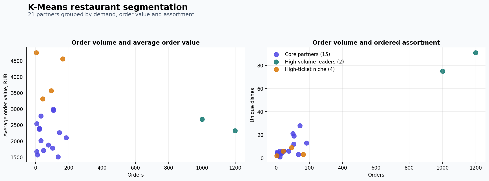
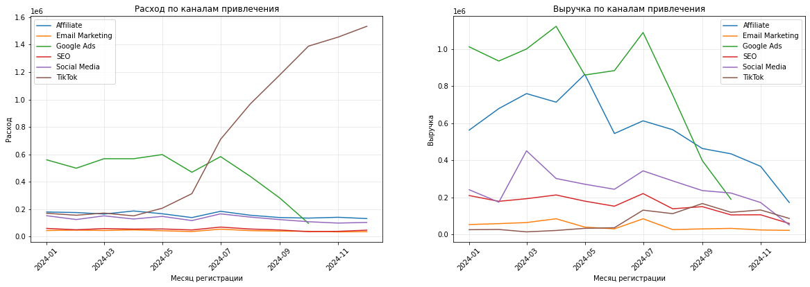
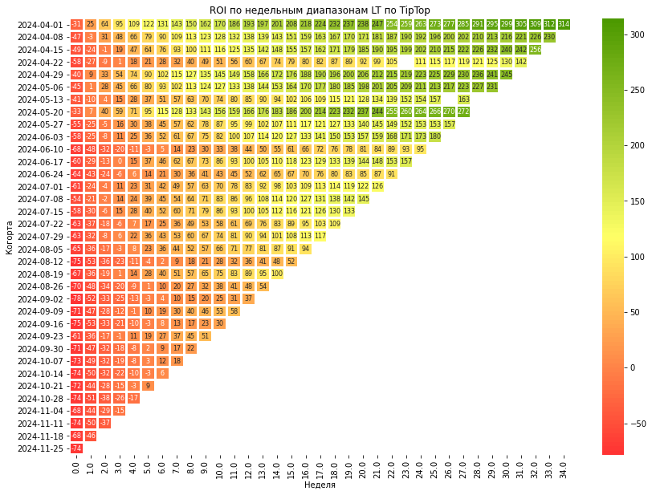
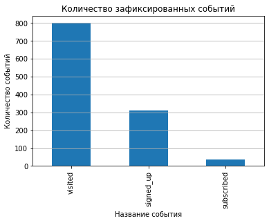
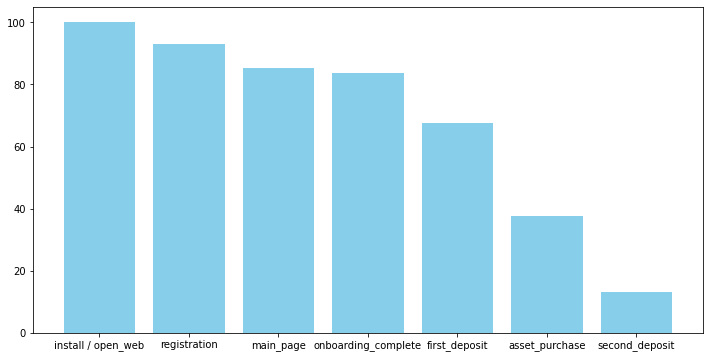
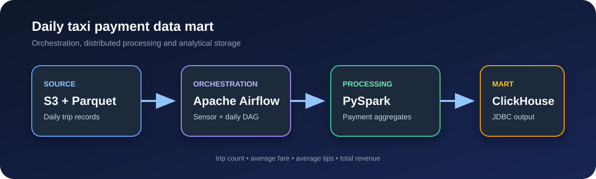

# Портфолио аналитика данных

Учебные проекты по продуктовой аналитике, машинному обучению, A/B-тестированию, SQL и построению аналитических пайплайнов. В каждом кейсе зафиксированы бизнес-задача, метод, измеримый результат, рекомендации и ограничения анализа.

## Избранные проекты

<table>
  <tr>
    <td width="50%" valign="top">
      <a href="./food-delivery-growth-segmentation/"></a>
      <br><strong><a href="./food-delivery-growth-segmentation/">Точки роста сервиса доставки</a></strong>
      <br>Воронки, RFM-сегментация покупателей и K-Means-кластеризация ресторанов. Два партнёра из кластера лидеров формируют около 62% оформленных заказов в событии <code>order</code>.
      <br><sub>Python · scikit-learn · RFM · K-Means</sub>
    </td>
    <td width="50%" valign="top">
      <a href="./marketplace-product-analytics/"></a>
      <br><strong><a href="./marketplace-product-analytics/">Продуктовая аналитика маркетплейса</a></strong>
      <br>Диагностика каналов, юнит-экономики и A/B-теста бонуса. Обнаружен неэффективный рост TikTok-трафика; в эксперименте конверсия выросла на 6,44 п. п.
      <br><sub>Python · когортный анализ · A/B-тест</sub>
    </td>
  </tr>
  <tr>
    <td width="50%" valign="top">
      <a href="./product-unit-economics/"></a>
      <br><strong><a href="./product-unit-economics/">Юнит-экономика Procrastinate Pro+</a></strong>
      <br>Анализ CAC, LTV, ROI и retention. Выявлены перегрев TipTop, убыточность FaceBoom и потенциал RocketSuperAds.
      <br><sub>Python · LTV/CAC/ROI · retention</sub>
    </td>
    <td width="50%" valign="top">
      <a href="./wid-product-analytics/"></a>
      <br><strong><a href="./wid-product-analytics/">Продуктовая аналитика WID</a></strong>
      <br>SQL-метрики, A/B-тест и дашборд. Регистрация через Яндекс ID увеличила конверсию на 7,17 п. п.
      <br><sub>Python · PostgreSQL · DataLens</sub>
    </td>
  </tr>
  <tr>
    <td width="50%" valign="top">
      <a href="./fintech-onboarding-ab-test/"></a>
      <br><strong><a href="./fintech-onboarding-ab-test/">A/B-тест обучающего онбординга</a></strong>
      <br>Проверка влияния обучения инвестиционным рискам. Конверсия во второй депозит выросла на 61% без значимого снижения первого депозита.
      <br><sub>Python · статистика · bootstrap</sub>
    </td>
    <td width="50%" valign="top">
      <a href="./taxi-payment-data-pipeline/"></a>
      <br><strong><a href="./taxi-payment-data-pipeline/">Витрина поездок такси</a></strong>
      <br>Ежедневный пайплайн от Parquet в S3 до аналитической витрины ClickHouse, оркестрируемый Airflow.
      <br><sub>PySpark · Airflow · S3 · ClickHouse</sub>
    </td>
  </tr>
</table>

## Все проекты

| Направление | Проект | Ключевая задача | Инструменты |
|---|---|---|---|
| Машинное обучение | [Сервис доставки](./food-delivery-growth-segmentation/) | Найти потери в воронке и сегментировать покупателей и рестораны | Python, RFM, K-Means |
| Продуктовая аналитика | [Маркетплейс](./marketplace-product-analytics/) | Найти причины снижения конверсии и оценить бонусный эксперимент | Python, когорты, A/B |
| Юнит-экономика | [Procrastinate Pro+](./product-unit-economics/) | Объяснить стагнацию выручки и перераспределить маркетинговый бюджет | Python, LTV, CAC, ROI |
| Продуктовая аналитика | [WID](./wid-product-analytics/) | Рассчитать метрики и оценить новый способ регистрации | Python, SQL, DataLens |
| Эксперименты | [Обучающий онбординг](./fintech-onboarding-ab-test/) | Оценить влияние обучения рискам на депозитную активность | Python, bootstrap, z-тест |
| Data engineering | [Витрина поездок такси](./taxi-payment-data-pipeline/) | Автоматизировать ежедневные агрегаты по способам оплаты | PySpark, Airflow, ClickHouse |
| Эксперименты | [Интерфейс интернет-магазина](./ecommerce-interface-ab-test/) | Сопоставить статистический эффект с бизнес-порогом | Python, z-тест |
| Статистика | [Активность читателей](./reading-app-hypothesis-test/) | Сравнить активность пользователей двух городов | Python, t-тест Уэлча |
| Инвестиционная аналитика | [Финансирование стартапов](./startup-funding-analysis/) | Выбрать перспективные отрасли и инструменты финансирования | Python, pandas, IQR |
| SQL | [Рынок вакансий](./sql-vacancy-analysis/) | Исследовать зарплаты, регионы, грейды и навыки аналитиков | PostgreSQL, DBeaver |
| SQL | [Donor Search](./donor-search-analysis/) | Найти точки роста повторных донаций | PostgreSQL, CTE, JOIN |
| SQL | [Недвижимость](./real-estate-listings-analysis/) | Исследовать сроки публикации и сезонность объявлений | PostgreSQL, окна, перцентили |

## Навыки

- **Продуктовая аналитика:** воронки, DAU/WAU/MAU, retention, когортный анализ, LTV, CAC и ROI;
- **Машинное обучение:** подготовка признаков, стандартизация, K-Means и интерпретация кластеров;
- **Эксперименты:** дизайн A/B-теста, проверка качества выборки, z-тест, t-тест Уэлча, bootstrap;
- **SQL:** CTE, оконные функции, `JOIN`, агрегации, сегментация и работа с датами;
- **Python:** pandas, NumPy, SciPy, statsmodels, Matplotlib и Seaborn;
- **Data engineering:** PySpark, Airflow, S3, Parquet, JDBC и ClickHouse;
- **Визуализация:** DataLens, когортные heatmap и представление выводов для бизнеса.

## Как открыть проекты

Все выводы и основные графики сохранены в ноутбуках. Учебные датасеты не публикуются, поэтому часть проектов нельзя полностью перезапустить без исходных данных.

```bash
git clone https://github.com/slava-ignatev/Practicum_projects.git
cd Practicum_projects
python -m venv .venv
source .venv/bin/activate
python -m pip install -r requirements.txt
jupyter lab
```

Для SQL-проектов требуется PostgreSQL-совместимая база с учебными таблицами. Для data engineering-проекта дополнительно нужны доступы к S3, ClickHouse и Airflow.
